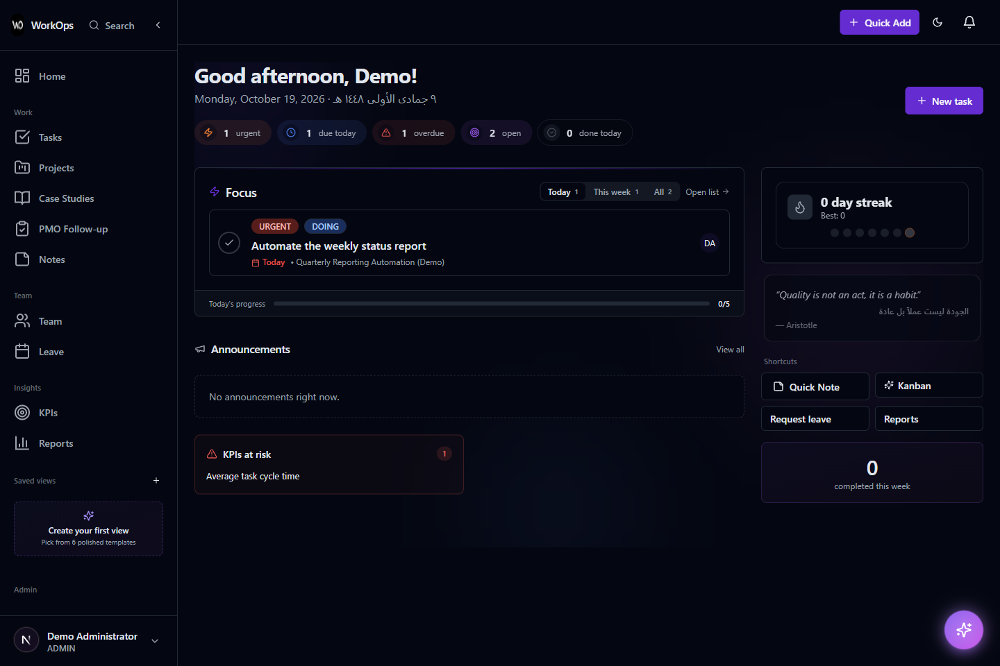
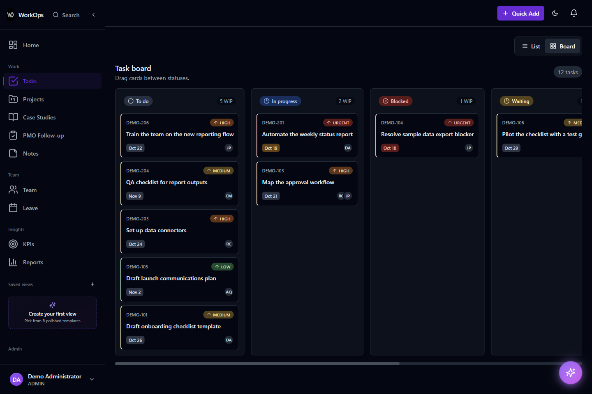
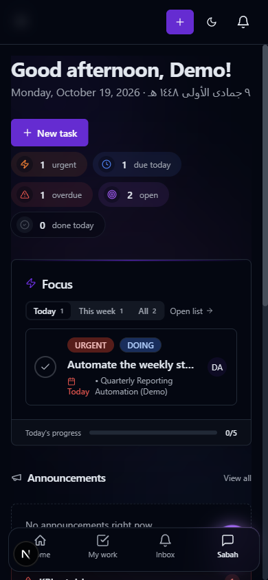

<div align="center">


# WorkOps

**Department work management — tasks, projects, capacity, and reporting — self-hosted under your control.**

[](LICENSE)

[](https://vercel.com/new/clone?repository-url=https%3A%2F%2Fgithub.com%2Fwa1939%2FWorkOps&env=DATABASE_URL%2CAUTH_SECRET%2CAUTH_TRUST_HOST%2CWORKOPS_DB_INIT_ON_BUILD%2CWORKOPS_BOOTSTRAP_ADMIN_ON_BUILD%2CADMIN_EMAIL%2CADMIN_PASSWORD&envLink=https%3A%2F%2Fgithub.com%2Fwa1939%2FWorkOps%2Fblob%2Fmain%2Fdocs%2Fdeployment%2Fvercel.md&project-name=workops)

</div>

WorkOps is an open-source work-management application for departments and small teams. It combines day-to-day task tracking, project delivery, workload planning, time and reporting, department-level KPIs, and an optional AI assistant in a single self-hostable web app.

It is designed for how departments actually work: shared goals owned by the whole team, managers coordinating capacity across people, and individual members who need one clear view of what is theirs today. Your data stays in your own PostgreSQL database.

## Highlights

- **Tasks, three ways** — spreadsheet-style grid, Kanban board, and Gantt timeline views of the same tasks, plus an unassigned "floating pool" that members can claim.
- **Projects with structure** — objectives, outputs, risks, stages, health, members, and a project roadmap on a Gantt timeline.
- **Load management & capacity planning** — see assignments and estimated effort across the team, review workload and utilization, and identify where to rebalance work before assigning more.
- **Reports & work briefs** — track time with entries and timers, review utilization and weekly progress, and generate AI-assisted executive summaries and project-scoped briefs using your chosen provider.
- **PMO & external actions** — follow projects and outside-team commitments through portfolio/timeline views, with accountable owners, due dates, evidence, reminder rules, follow-up history, and exports.
- **Department KPIs** — a shared scorecard with updates and reminders. KPIs belong to the department, not to individuals.
- **Custom views & personal home** — a block-based editor (task lists, charts, stat tiles, notes, embeds) for building saved views, with an opt-in custom home page.
- **The operational periphery** — notes (markdown + tags), leave requests with task handover, announcements, an inbox with notification preferences, and case studies.
- **Roles & workspaces** — department-level roles (Admin, Manager, Member, Viewer) plus scoped workspaces with their own membership.
- **Optional AI assistant (Sabah)** — chat, task intake, and field assistance with permission-grounded, reviewable workflows. Explicit approvals for write actions; fully optional and off unless you configure it.

## Screenshots

These are genuine captures of this checkout running locally with synthetic demo data. No operational or customer data is shown.

| Dashboard | Task board | Mobile |
| --- | --- | --- |
|  |  |  |

## Documentation

| Document | Contents |
| --- | --- |
| [Getting started](docs/getting-started.md) | Install, configure, initialize the database, first admin, first run |
| [User guide](docs/user-guide.md) | How each module works, day to day |
| [Capabilities](docs/capabilities.md) | Feature-by-feature reference, including what requires configuration |
| [Configuration](docs/configuration.md) | Environment variables, integrations, scheduled jobs |
| [Architecture](docs/architecture.md) | Stack, data model, auth, and the AI subsystem |
| [Development](docs/development.md) | Local development, tests, migrations |
| [FAQ](docs/faq.md) | Common questions about data, AI, and operations |
| [Roadmap](ROADMAP.md) | Now / Next / Later — direction, not commitments |

Deployment guides: [Vercel](docs/deployment/vercel.md) · [Self-hosting](docs/deployment/self-hosting.md) · [Database setup](docs/deployment/database.md)

## Quick start (local development)

Prerequisites: Node.js 22.22.2 or a compatible newer runtime (see `engines` in `package.json`), PostgreSQL 16, and npm.

```bash
git clone https://github.com/wa1939/WorkOps.git
cd WorkOps
npm ci

# Configure the app
cp .env.example .env
#   - DATABASE_URL  → your local PostgreSQL database
#   - AUTH_SECRET   → generate with: openssl rand -base64 32

# Initialize a NEW database and create the first administrator
npm run db:setup        # safe initialization for an empty database
npm run setup:admin     # interactive first-admin bootstrap

# Optional: load synthetic data into an isolated local installation
WORKOPS_DEMO_SEED=1 npm run db:demo

# Run
npm run dev             # http://localhost:3000
```

`db:setup` refuses an existing or unknown non-empty database. `setup:admin` refuses an installation that already has users; it never resets accounts. Use `npm run setup:verify` for a read-only installation check. See [database setup](docs/deployment/database.md) for initialization and safe upgrades.

## Deployment

WorkOps is a standard Next.js (App Router) application with a PostgreSQL database, so it runs anywhere Node runs.

- **Vercel** — see [docs/deployment/vercel.md](docs/deployment/vercel.md)
- **Self-hosting (Docker / your own server)** — see [docs/deployment/self-hosting.md](docs/deployment/self-hosting.md)
- **Database initialization and migrations** — see [docs/deployment/database.md](docs/deployment/database.md)

### Deploy on Vercel

The **Deploy with Vercel** button at the top of this README creates a Vercel project from this repository and prompts for the required setup variables before the first build:

- `DATABASE_URL` — a PostgreSQL connection string. Any standard PostgreSQL provider works (Vercel Postgres, Neon, Supabase, or your own server); WorkOps does not depend on a specific database vendor.
- `AUTH_SECRET` — generate a unique signing secret with `openssl rand -base64 32`; set `AUTH_TRUST_HOST=true`.
- For a fresh empty database, set **`WORKOPS_DB_INIT_ON_BUILD=1`** and **`WORKOPS_BOOTSTRAP_ADMIN_ON_BUILD=1`** (exactly `1`, not `true`). Provide your own `ADMIN_EMAIL` and a unique `ADMIN_PASSWORD` of at least 12 characters, including letters and digits.
- The canonical origin can use Vercel's production-alias system variable on the first deployment. Set `NEXTAUTH_URL` / `APP_BASE_URL` for your final custom domain; see the guide for system-variable requirements.

Database setup is **opt-in, never implicit**. The two first-install gates initialize the schema and create a verified administrator with OWNER workspace membership in the same deployment. After signing in, disable both gates and remove `ADMIN_PASSWORD` from platform settings. `WORKOPS_DB_MIGRATE_ON_BUILD=1` is a separate pending-migration opt-in for environments that own their database; preview builds refuse setup flags. Full details: [docs/deployment/vercel.md](docs/deployment/vercel.md).

This flow is documented and has been exercised locally against the real build; it has not yet been verified on a live cloud deployment, and supplying your own PostgreSQL database is part of setup — it is not a zero-config deploy.

Scheduled background jobs (reminders, digests, recurring tasks) run through authenticated HTTP endpoints — [Configuration](docs/configuration.md) covers how to trigger them.

## Configuration at a glance

| Variable | Required | Purpose |
| --- | --- | --- |
| `DATABASE_URL` | ✅ | PostgreSQL connection string |
| `AUTH_SECRET` | ✅ | Auth.js (NextAuth) JWT signing secret |
| `NEXTAUTH_URL` / `APP_BASE_URL` | ✅ | Canonical origin for callbacks and links |
| `RESEND_API_KEY`, `EMAIL_FROM` | optional | Transactional email (verification, password reset, notifications) |
| `AI_PROVIDER`, `AI_MODEL`, `AI_API_KEY` | optional | Your choice of OpenAI, native Anthropic/Claude, or a custom OpenAI-compatible service; custom services also use `AI_BASE_URL`. Existing GLM/Nuha variables remain supported. |
| `AZURE_AD_CLIENT_ID` / `_SECRET` / `_TENANT_ID` | optional | Microsoft Entra ID sign-in alongside credentials |
| `CRON_SECRET` | optional | Protects scheduled-job endpoints |
| `SABAH_CREDENTIAL_KEY` | optional | Encrypts admin-managed AI provider credentials |

The full reference, including optional web-push and webhook settings, is in [docs/configuration.md](docs/configuration.md).

## About the AI features

AI in WorkOps is **optional and bring-your-own-provider**. Choose OpenAI, native Anthropic/Claude, or a custom OpenAI-compatible service such as Nuha; define the key and exact model ID, plus the endpoint for custom services. GLM is supported for backward compatibility, not required. See [AI configuration](docs/configuration.md#ai-optional). When enabled:

- The assistant operates within the signed-in user's permissions — it does not see data the user cannot see.
- Write actions go through reviewable workflows with explicit approvals.
- Prompts and context are sent to the model provider you configure; self-hosters choose which provider (and therefore which jurisdiction) that is.
- Advanced job/monitor/model-assignment features require explicit admin configuration.

Details: [docs/architecture.md](docs/architecture.md) (AI subsystem) and [docs/capabilities.md](docs/capabilities.md).

## Project status

WorkOps is developed in the open in this repository, but it is young software: there is no hosted demo, no release yet, and no paid tiers — this is an MIT-licensed application you run yourself. The documented Vercel deployment flow has been exercised locally but has not yet been verified against a live cloud deployment.

Report reproducible problems through the channels in [SUPPORT.md](SUPPORT.md).

## Community

- [Contributing](CONTRIBUTING.md) — how to set up, branch, test, and submit changes
- [Security policy](SECURITY.md) — how to report vulnerabilities
- [Code of conduct](CODE_OF_CONDUCT.md)
- [Support](SUPPORT.md) — where to ask questions

## License

[MIT](LICENSE) © 2026 Waleed Alhamed. Third-party components are covered by their own licenses; see [THIRD_PARTY_NOTICES.md](THIRD_PARTY_NOTICES.md).
